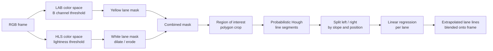

# Road Lane Line Detection

**Computer Vision · AI project**

A real-time computer vision pipeline that finds lane lines in road images and dashcam video using Python, OpenCV and NumPy. It handles white and yellow markings, solid and dashed lines, and shadowed road surfaces without any machine learning model or GPU.


---

## Highlights

- **Runs in real time on a plain CPU:** 50 to 55 frames per second on 960×540 video and about 34 fps on 720p, measured on a 2-core cloud CPU.
- **Robust to shadows and mixed markings:** yellow and white lanes are found in separate color spaces, then merged, and the pipeline holds up on the shadowed "challenge" clip.
- **Reliable end to end:** all 1,153 frames across the three test videos processed without a single error.
- **Explainable by design:** every stage produces an image you can inspect, so tuning and debugging are fast.

## Results

| Test video | Resolution | Frames | Throughput | Latency per frame |
|---|---|---|---|---|
| `solidWhiteRight.mp4` | 960×540 | 221 | ~55 fps | ~18 ms |
| `solidYellowLeft.mp4` | 960×540 | 681 | ~55 fps | ~18 ms |
| `challenge.mp4` (shadows, curve, concrete patch) | 1280×720 | 251 | ~34 fps | ~29 ms |

*Benchmark: `process_image()` timed per frame with OpenCV 4.14 on a 2-core x86 CPU, video decoding excluded. Your numbers will vary with hardware.*

Before and after on the test images:


Full output videos are in [`test_videos_output/`](test_videos_output) and annotated stills in [`test_images_output/`](test_images_output).

---

## Pipeline architecture



## How it works

### 1. Problem

Lane markings vary in color (white, yellow), style (solid, dashed) and contrast, and shadows or bright concrete can hide them. The goal is a pipeline that finds both lane boundaries in every frame, fast enough for live video.


### 2. Yellow lines: LAB color space

In the LAB color space the **B channel** separates yellow from everything else, and it stays stable in shade. A `cv2.inRange()` threshold on LAB gives a clean yellow mask.


### 3. White lines: HLS color space

White markings have high **lightness**, so they are isolated in HLS. Morphological `dilate` → `erode` → `dilate` steps close gaps in dashed lines. This step also picks up noise (the white car on the right), which the next stages remove.


### 4. Combine the masks

The yellow and white masks are added together into one lane mask. Some roadside yellow signs appear here too; they are outside the road area and get cropped next.


### 5. Region of interest

A trapezoid covering the road ahead is kept and everything else is blacked out. The car and signs disappear, leaving only lane pixels.


### 6. Hough transform

`cv2.HoughLinesP` turns the mask into line segments. Both line types are found even under shadow.


### 7. From segments to two lanes

Segments are classified by slope sign and by which half of the frame they are in. Near-horizontal segments (|slope| ≤ 0.5) are discarded as noise. A linear regression (`scipy.stats.linregress`) through each side's points gives one line per lane, extended from the bottom of the frame to about 63% of its height, then blended onto the original frame.

## Design decisions

| Decision | Why | Trade-off |
|---|---|---|
| Separate color spaces for yellow (LAB) and white (HLS) | HSV, HLS and LAB were compared channel by channel; LAB's B channel isolated yellow best in shaded frames, and HLS lightness isolated white | Two thresholds to tune instead of one |
| Morphology instead of edge detection | Keeps filled lane regions and joins dashed segments; adding a Canny filter on top gave no improvement | Also thickens some noise, which the ROI step removes |
| Region of interest before Hough | Removes cars, signs and roadside clutter before line fitting | Polygon is fixed per resolution (see limitations) |
| Linear regression over segments | Turns many short, noisy segments into one full line per lane | Cannot follow sharp curves |
| Classical CV, no neural network | Runs in real time on CPU, and every step can be inspected | Thresholds are tuned by hand rather than learned |

## Project structure

```
Road-Lane-Line-Detection/
├── _Road Lane Line Detection.ipynb   # full pipeline, exploration and video processing
├── asset/                            # README figures and demo GIFs
├── test_images/                      # input frames
├── test_images_output/               # annotated frames
├── test_videos/                      # input dashcam clips
├── test_videos_output/               # processed clips with lane overlay
├── requirements.txt
└── LICENSE
```

## Getting started

```bash
git clone https://github.com/Ad1ba19/Road-Lane-Line-Detection.git
cd Road-Lane-Line-Detection
python -m venv .venv && source .venv/bin/activate
pip install -r requirements.txt
jupyter notebook "_Road Lane Line Detection.ipynb"
```

Run the cells top to bottom. The notebook processes the test images, then writes the three output videos to `test_videos_output/`.

> **Note:** the pipeline needs **OpenCV 4.x**. OpenCV 5 changed the array shape returned by `cv2.HoughLinesP`, and the line-drawing step fails on it, so `requirements.txt` pins `opencv-python<5`.

## Limitations and next steps

Knowing where a system breaks matters as much as where it works.

- **Fixed region of interest:** the crop polygon is hard-coded for two resolutions (960×540 and 1280×720). Next step: derive it from the frame size or a camera calibration.
- **Straight-line model:** sharp curves are approximated by a straight line. Next step: fit a second-order polynomial after a perspective (bird's-eye) transform.
- **No temporal smoothing:** each frame is processed independently, so lines can jitter. Next step: smooth slope and intercept across frames with an exponential moving average.
- **Hand-tuned thresholds:** color ranges were tuned on this dataset and may need adjusting for night, rain or worn paint.
- **No ground-truth accuracy score:** results are checked visually. Next step: label a small set of frames and report a detection rate.
- **Notebook format:** next step is a `lane_detection` Python package with a CLI and unit tests, so the pipeline can be reused outside Jupyter.

## Acknowledgements

Built as part of the Udacity Self-Driving Car Engineer Nanodegree. Test images and videos come from the Udacity course materials.

## License

Released under the MIT License. See [LICENSE](LICENSE).

---

## Author

**Adiba Khan** · Software Engineer · Backend & AI Systems

[](https://github.com/Ad1ba19)
[](https://www.linkedin.com/in/adiba-khan-20ba57230/)
